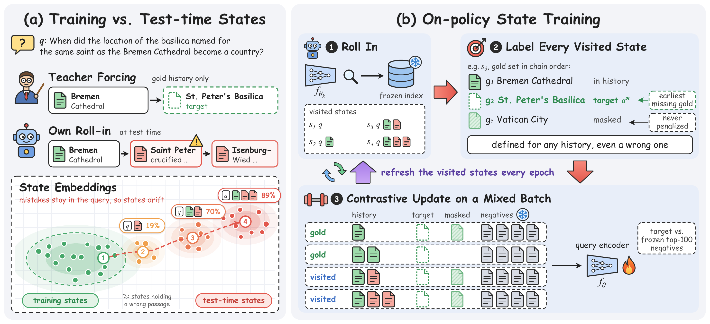
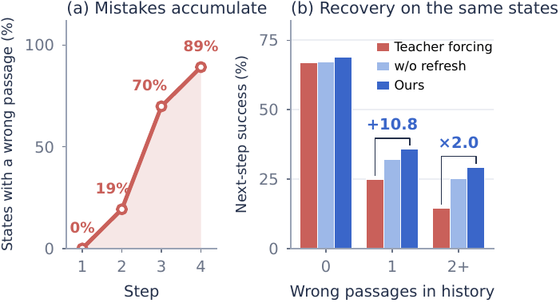
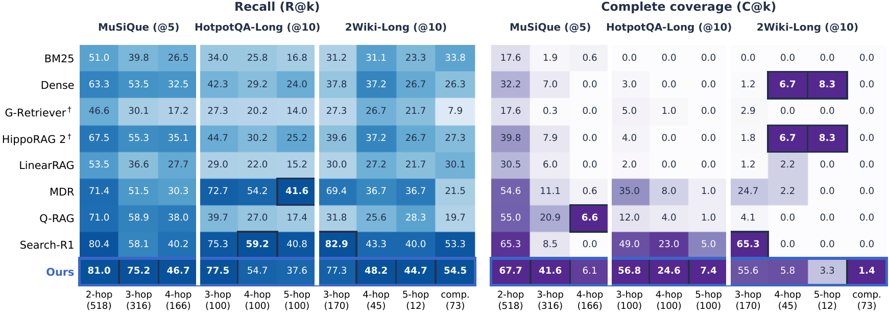
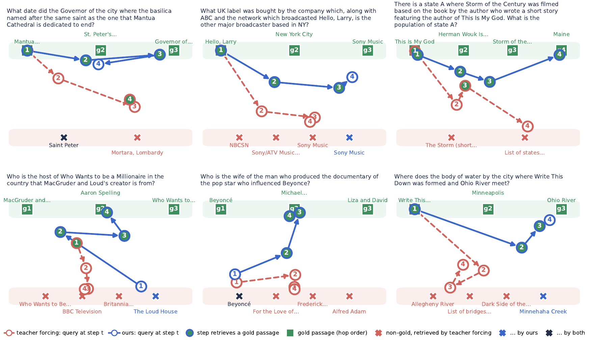
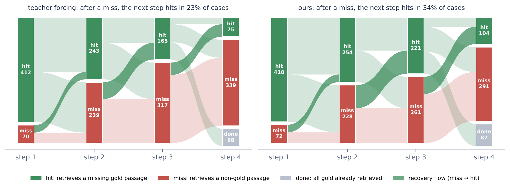

<div align="center">

# Retrieving from Your Own Mistakes

### On-Policy Training of Embedding Models for Multi-Hop Retrieval-Augmented Generation

**English** · [简体中文](README_zh.md)


</div>

<p align="center">
  
</p>

> **(a)** Teacher forcing trains a chain retriever on gold histories, while at test time its own mistakes stay in the query.
> **(b)** On-policy state training rolls in the current encoder, labels every visited state with the earliest missing gold passage, and trains on a mix of gold and visited states that is refreshed every epoch.

---

## Highlights

- **A strong retriever without a language model.** A 0.6B chain embedding retriever, trained with query-side LoRA and a single dense index, completes more evidence chains on MuSiQue than graph-based RAG systems and a 7B search agent.
- **The state mismatch is large.** By the third step, about half or more of the states that a teacher-forced chain retriever visits already contain one of its own mistakes, and those mistakes alone cost it 11 points of next-step success.
- **One change, measurable gain.** Changing only the distribution of training states raises complete coverage on MuSiQue (C@5 44.6 → 50.5 against matched teacher forcing) and transfers without further training to longer chains.
- **The gain is where the mismatch predicts.** On the same fixed states, the on-policy encoder recovers after a mistake about twice as often, and refreshing the visited states with the current encoder accounts for the part that synthetic contamination does not.

## Why it matters

<table>
<tr>
<td width="50%"></td>
<td width="50%">

**(a) Mistakes accumulate.** On four-hop MuSiQue questions, 19%, 70% and 89% of the teacher-forced retriever's states at steps 2–4 already hold a wrong passage.

**(b) Recovery on the same states.** Scored on one fixed set of states, all encoders are close when the history is clean. After two or more wrong passages, on-policy state training succeeds about twice as often as teacher forcing.

</td>
</tr>
</table>

## Method in one paragraph

A chain retriever encodes the state `(question, passages retrieved so far)` and retrieves the next passage. Each epoch, the current encoder runs its greedy chain on the training questions. Every visited state that still misses a gold passage is labeled with the **earliest** missing gold passage, and the other missing gold passages are **masked** from the contrastive denominator, so no correct continuation is penalized. The query encoder is then trained on an equal mix of these visited states and teacher-forced states. The architecture, loss, frozen-encoder negatives and document index are shared with teacher forcing, so the two regimes differ only in their training states.

## Results

Retrieval on MuSiQue and on two long-chain benchmarks that we construct (our retriever is trained on MuSiQue only; mean of five seeds).

| Method | MuSiQue R@5 | MuSiQue C@5 | HotpotQA-Long C@10 | 2Wiki-Long C@10 | LLM at retrieval |
|---|:---:|:---:|:---:|:---:|:---:|
| Dense (Qwen3-Embedding-0.6B) | 55.1 | 18.9 | 1.0 | 2.0 | – |
| HippoRAG 2 | 58.2 | 23.1 | 1.3† | 2.3† | ✓ |
| MDR | 58.3 | 31.9 | 14.7 | 14.3 | – |
| Q-RAG | 61.7 | 36.2 | 5.7 | 2.3 | – |
| Search-R1 (7B) | 66.7 | 36.5 | 25.7 | **37.0** | ✓ |
| **On-policy state training** | **73.5** | **49.3** | **29.6** | 32.8 | – |

† reduced corpora, an easier setting than the full corpora. Full table with recall and coverage at 5 and 10 in the paper (Table 1).

<p align="center">
  
</p>
<p align="center"><sub>Recall and complete coverage by question type.</sub></p>

Ablations (one shared seed):

| | MuSiQue C@5 | HotpotQA-Long C@10 | 2Wiki-Long C@10 |
|---|:---:|:---:|:---:|
| **On-policy state training** | **50.5** | **28.0** | **34.7** |
| w/o refresh | 48.4 | 22.7 | 28.3 |
| w/o on-policy states (teacher forcing) | 44.6 | 22.3 | 24.3 |
| w/o chain | 18.9 | 1.0 | 1.7 |

## Where the query points

<p align="center">
  
</p>

Once the teacher-forced chain retrieves a non-gold passage, its next query points at the non-gold passages and stays there. The on-policy query moves along the gold row hop by hop and returns to it within one or two steps when it starts near a wrong passage.

<p align="center">
  
</p>
<p align="center"><sub>Step-by-step outcomes on three- and four-hop MuSiQue questions; dark bands are recoveries from a miss to a hit.</sub></p>

## Repository layout

```
on-policy-state-training/
├── src/
│   ├── round29/       core retriever: state serialization, roll-ins, state mixing, training, chain inference
│   ├── longchain/     zero-shot evaluation on HotpotQA-Long and 2Wiki-Long (T = 8)
│   ├── round78/       shared negative pools, fixed-state recovery probe, pool overlap
│   └── round87/       mechanism controls: synthetic contamination, resampling from one roll-in
├── experiments/
│   ├── beam/          greedy vs. beam decoding
│   ├── qa/            downstream QA with a fixed reader
│   ├── reduced_corpus/
│   └── baselines/     Search-R1, Q-RAG, MDR, G-Retriever, LinearRAG
├── benchmarks/
│   ├── code/          construction pipeline, prompts, verification and shortcut filters
│   └── data/          released questions and ordered gold chains
├── figures/           plotting scripts
└── assets/            images used in this README
```

| Folder | Paper |
|---|---|
| `src/round29` | Sections 3–5, Tables 1–4 |
| `src/longchain` | Tables 1 and 3 |
| `src/round78` | Sections 5.4 and 5.5.2, Appendix B |
| `src/round87` | Section 5.5.1, Table 4 |
| `experiments/beam` | Appendix F.3 |
| `experiments/qa` | Table 2, Appendix F.1 |
| `experiments/reduced_corpus` | Appendix D |
| `experiments/baselines` | Table 1 |
| `benchmarks` | Section 5.1, Appendix E |
| `figures` | Figures 2–7 |

Each folder has its own README. Scripts are kept as they were run; the number in a file name is the experiment round it comes from.

## Quick start

```bash
pip install -r requirements.txt

# teacher forcing (RN) and on-policy state training (OP-refresh) on MuSiQue
python src/round29/train29.py --condition RN         --lr 3e-4 --seed 13
python src/round29/train29.py --condition OP-refresh --lr 3e-4 --seed 13

# chain retrieval on the MuSiQue test questions
python src/round29/evaluate29.py --condition OP-refresh --seed 13 --split design

# zero-shot transfer to the long-chain benchmarks
python src/longchain/eval54.py --dataset hotpotqa_long --condition OP-refresh --seed 13
python src/longchain/eval54.py --dataset 2wiki_long    --condition OP-refresh --seed 13
```

Other conditions used in the paper: `Fixed-OP` (w/o refresh) and `SQ-LoRA-v2` (w/o chain).

## Benchmarks

| | Chains | Test questions | Corpus |
|---|---|---|---|
| **HotpotQA-Long** | 3, 4 and 5 hops along Wikipedia hyperlinks | 100 per length | 554,812 passages |
| **2Wiki-Long** | 3–5 hops over functional Wikidata relations, plus comparisons of 3–4 entities | 170 / 45 / 12 chains, 73 comparisons | 220,000 passages |

Questions name only the starting entity. A model of a different family re-checks answerability and uniqueness, and questions whose final passage BM25 retrieves from the question alone are removed. `benchmarks/data` holds the test questions with ordered gold chains. The corpora exceed GitHub's file limit and are rebuilt with `benchmarks/code` (see its README).

## Environment and notes

- Python 3.11, torch 2.5.1 (CUDA 12.4), transformers 4.51.3, peft 0.17.1, numpy 1.26.4, faiss 1.9.0. Baselines use their official repositories.
- **Not included:** model weights, LoRA adapters, passage embeddings, the full long-chain corpora, logs and intermediate outputs.
- Scripts contain absolute paths of the machines they ran on (for example `/data1/...`). Adapt them, or set the environment variables `R29_DIR`, `R19_MODEL` and `R70_BASE` that most scripts read.
- Language model calls read `DEEPSEEK_API_KEY` and `DEEPSEEK_BASE_URL` from the environment.

## Citation

```bibtex
@article{qiu2026retrieving,
  title   = {Retrieving from Your Own Mistakes: On-Policy Training of Embedding Models
             for Multi-Hop Retrieval-Augmented Generation},
  author  = {Qiu, Chenjie and Zeng, Zixuan and Shi, Shaobin and Chen, Bingfeng and Luo, Dongsheng and Xu, Boyan},
  journal = {arXiv preprint},
  year    = {2026}
}
```
